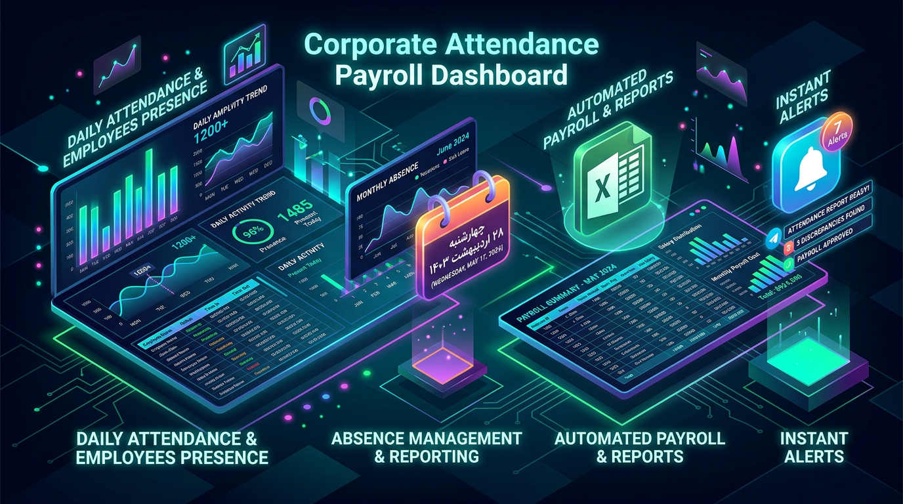
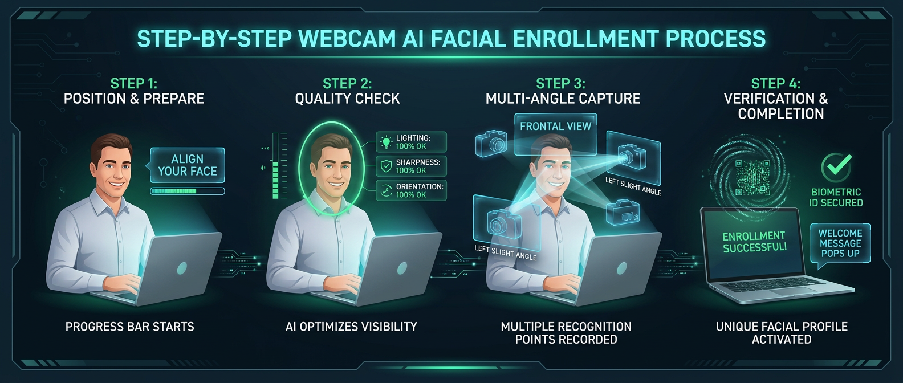

# 📖 دفترچه راهنمای جامع مشتریان و شرکت‌ها (Client User Manual)
### سامانه هوشمند حضور و غیاب و تشخیص چهره سرمد (SARMAD Attendance)

---

## 🏢 ۱. پیام خوش‌آمدگویی به سازمان خریدار

مدیر و کارفرمای گرامی،  
از حسن انتخاب و اعتماد شما به **سامانه هوشمند حضور و غیاب سرمد** صمیمانه سپاسگزاریم.  
این سامانه با بهره‌گیری از جدیدترین فناوری‌های پردازش تصویر محلی (Edge AI)، ثانیه‌ای دقیق، محاسبهٔ خودکار کسر کار و اضافه‌کار، و بدون نیاز به خرید دستگاه‌های گران‌قیمت یا وابسته، تردد پرسنل مجموعهٔ شما را متحول می‌سازد.

این دفترچه به گونه‌ای طراحی شده که بتوانید در کمتر از **۱۵ دقیقه**، سیستم را از صفر تا صد راه‌اندازی کرده و اولین تردد پرسنل خود را ثبت فرمایید.

---

## 🔑 ۲. اطلاعات حساب کاربری سازمان شما

پس از خرید اشتراک، اطلاعات اختصاصی زیر در اختیار شما قرار گرفته است:

- **آدرس اختصاصی سامانه شما:** `https://finger.sarmadfallahzadeh.ir/`
- **پنل مدیریت کارفرما:** `https://finger.sarmadfallahzadeh.ir/login`
- **نام کاربری مدیر:** (توسط ارائه‌دهنده برای شما تعیین شده است)
- **رمز عبور اولیه:** (توسط ارائه‌دهنده برای شما تعیین شده است)

---

## 🧭 ۳. نقشه راه سریع راه‌اندازی (در ۴ گام)


```text
[ گام ۱: ورود و شیفت‌ها ] ➔ [ گام ۲: تعریف پرسنل ] ➔ [ گام ۳: ثبت چهره با وب‌کم ] ➔ [ گام ۴: فعال‌سازی تبلت شرکت ]
```

---

## ⏰ ۴. گام اول: ورود به پنل و تعریف شیفت‌های کاری



1. آدرس سامانه را در مرورگر باز کنید و وارد حساب کاربری مدیر شوید.
2. از منوی سمت راست روی **«شیفت‌ها»** کلیک کنید و دکمه **«افزودن شیفت جدید»** را بزنید:
   - **نام شیفت:** مثلاً *شیفت اداری صبح* یا *شیفت عصر*.
   - **ساعت شروع و پایان:** مثلاً `08:00` تا `16:30`.
   - **فرجهٔ مجاز تأخیر:** دقایقی که کارمند بدون ثبت جریمه می‌تواند دیرتر بیاید (مثلاً ۱۵ دقیقه).
   - **فرجهٔ مجاز تعجیل:** دقایقی که خروج زودتر از موعد مجاز است (مثلاً ۱۰ دقیقه).
   - **زمان استراحت/ناهار:** مثلاً ۳۰ دقیقه (از کارکرد کسر می‌شود).
3. روی **ذخیره شیفت** کلیک کنید.

---

## 👥 ۵. گام دوم: ثبت مشخصات پرسنل

1. از منوی سمت راست وارد بخش **«پرسنل»** شوید.
2. روی دکمه آبی‌رنگ **«افزودن پرسنل جدید»** کلیک کنید:
   - نام و نام خانوادگی، کد پرسنلی (مثلاً ۱۰۰۱)، شماره موبایل و کد ملی.
   - **شیفت کاری:** شیفتی که در مرحله قبل ساختید را به این کارمند اختصاص دهید.
   - **نوع قرارداد:** تمام‌وقت، پاره‌وقت یا کارآموز.
   - *(کادر «تصویر پرسنل» کاملاً اختیاری است و فقط عکس پرونده است؛ تشخیص چهره در مرحله بعد با دوربین انجام می‌شود).*
3. دکمه **«ثبت کارمند»** را بزنید.

---

## 📸 ۶. گام سوم: ثبت چهره کارمند با وب‌کم (Face Enrollment)



برای هر کارمند، سامانه هوش مصنوعی ۳ نمونه باکیفیت از زاویه چهره را دریافت و ذخیره می‌کند:

1. وارد صفحه کارمند شوید و دکمهٔ **«ثبت چهره پرسنل»** را بزنید.
2. دوربین لپ‌تاپ یا گوشی مدیر روشن می‌شود (گزینه Allow Camera در مرورگر را تأیید کنید).
3. کارمند در فاصله ۶۰ تا ۸۰ سانتی‌متری روبروی دوربین می‌ایستد:
   - **نمونه اول:** نگاه کاملاً مستقیم به دوربین (کادر بیضی سبز می‌شود).
   - **نمونه دوم:** متمایل ملایم به سمت راست یا چپ.
   - **نمونه سوم:** لبخند ملایم یا زاویه اندک متفاوت.
4. با فشردن دکمه ثبت (یا اسکن خودکار)، هوش مصنوعی بردار ۱۲۸ بعدی را استخراج کرده و پیام **«کامل — ۳ از ۳ نمونه»** نمایش داده می‌شود.

> 💡 **نکته امنیتی سامانه سرمد:**  
> تصاویر خام ویدیویی پرسنل به هیچ سروری ارسال نمی‌شوند؛ تمامی پردازش‌های هوش مصنوعی به‌صورت محلی (On-Device) در کسری از ثانیه انجام می‌گیرد.

---

## 📱 ۷. گام چهارم: راه‌اندازی دستگاه حضور و غیاب شرکت (حالت کیوسک)


هر تبلت، گوشی یا مانیتور لمسی در ورودی سازمان شما، با این قابلیت به دستگاه حضور و غیاب تبدیل می‌شود:

### الف) دریافت کد اتصال:
- در پنل مدیر، به منوی **«دستگاه‌ها»** بروید و دکمه **«کد فعال‌سازی جدید»** را بزنید.
- یک کد ۱۰ رقمی (مثلاً `123456-7890`) دریافت خواهید کرد.

### ب) اجرای کیوسک روی تبلت ورودی شرکت:
1. روی تبلت شرکت مرورگر را باز کرده و آدرس زیر را وارد کنید:  
   👉 `https://finger.sarmadfallahzadeh.ir/device`
2. کد ۱۰ رقمی را روی صفحه لمسی وارد کنید.
3. تبلت فوراً لوگو، نام شرکت و ساعت دقیق دیجیتال را نمایش می‌دهد و برای همیشه فعال می‌ماند.

### ج) نحوه تردد روزانه پرسنل:
- کارمند به ورودی می‌رسد و دکمه بزرگ **«ورود»** یا **«خروج»** را لمس می‌کند.
- دوربین صورت را اسکن کرده و در کمتر از **۰.۴ ثانیه** پیام سبز رنگ:  
  *«ورود شما در ساعت ۰۸:۰۴ با موفقیت ثبت شد - نام کارمند»* را با صدای بوق تأیید پخش می‌کند.
- **کارکرد آفلاین:** حتی اگر اینترنت شرکت قطع شود، تبلت ترددها را ثبت کرده و به محض وصل شدن اینترنت به صورت خودکار با سرور هماهنگ (Sync) می‌شود.

---

## 📊 ۸. مشاهده ترددها و دانلود خروجی اکسل (حسابداری و حقوق)

در پایان روز یا پایان ماه:
1. از منوی سمت راست وارد **«حضور و غیاب»** شوید تا کارت‌های آنلاین (حاضران، غایبان، تأخیرها) را ببینید.
2. برای ارسال به واحد مالی و حقوق دستمزد:
   - به بخش **«گزارش‌ها»** بروید.
   - بازه زمانی ماهانه (مثلاً از اول تا پایان ماه جاری) را انتخاب کنید.
   - دکمه **«دانلود خروجی اکسل (.xlsx)»** را بزنید.
   - فایل اکسل راست‌به‌چپ (RTL)، مرتب و فرمول‌بندی شده با مجموع کارکرد، کسر کار، اضافه‌کار و مرخصی‌ها دریافت خواهد شد.

---

## ❓ ۹. سؤالات متداول (FAQ)

- **آیا کارمندان می‌توانند با عکس یا تصویر داخل گوشی تقلب کنند؟**  
  خیر؛ الگوریتم هندسهٔ چهره و کیفیت عمق و ابعاد را می‌سنجد و زوایای نامتعارف را نمی‌پذیرد.
- **اگر برق یا اینترنت قطع شود چه می‌شود؟**  
  تبلت در حالت آفلاین روی باتری خود به ثبت تردد ادامه می‌دهد و صف آفلاین ذخیره می‌ماند.
- **آیا امکان ثبت مرخصی و مأموریت وجود دارد؟**  
  بله؛ در منوی «مرخصی‌ها»، انواع مرخصی استحقاقی، استعلاجی و ساعتی قابل ثبت و تایید است و خودبه‌خود از محاسبات کسر کار خارج می‌شود.

---

**مرکز پشتیبانی و خدمات پس از فروش:**  
در صورت نیاز به راهنمایی یا ارتقای اشتراک، با پشتیبانی فنی شرکت در ارتباط باشید.
